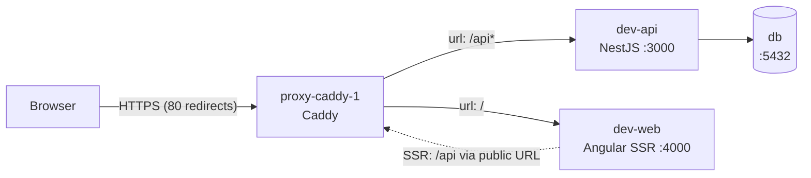

# Netweave

## How to get started

Run Netweave locally from source ([2A.](#2a-recommended-run-from-source)). It uses Angular's development server with live reload, and Docker only for the local database and Mailpit.\
`docker-compose.yml` ([2B.](#2b-run-with-docker-compose)) is the server deployment file and not meant for local use.

## About

See our [Glossary](./docs/glossary.md) or [Use Case Diagram](./docs/use-case-diagram.puml)

### 1. Shared setup

1. Install Node.js and npm, then install the project dependencies from the
   repository root:

   ```sh
   npm ci
   ```

2. Create the local environment file:

   ```sh
   cp .env.example .env
   ```

3. Fill in the values in `.env`; `.env.example` documents every variable. At
   minimum, configure the PostgreSQL connection, `JWT_SECRET`, and the mail
   settings. Set `SEND_MAIL_ACTIVATED=false` when you do not want the
   application to send mail during local development.

4. Only whitelisted emails can register. On a fresh instance, set
   `REGISTRATION_WHITELIST` (e.g. `you@example.com:admin`) so the first admin
   can register. More emails and domains, each with an optional role, can then
   be allowed from the settings page. New users get the role `viewer` unless
   their whitelist entry says otherwise.

### 2A. Recommended: run from source

This workflow needs Docker for the local database and Mailpit. Start both:

```sh
  docker compose -f docker-compose.local.yml up -d
```

The database uses the credentials from `.env` (`DB_USER`, `DB_PASSWORD`, `DB_DB`) and listens on `localhost:5432`.\
`docker compose -f docker-compose.local.yml down -v` deletes it for a fresh start.

Start the frontend and API together:

```sh
  npm run serve
```

Then open [http://localhost:4200](http://localhost:4200). Nx starts the API as
a dependency of the web development server. The API listens at
[http://localhost:3000/api](http://localhost:3000/api), and the Angular proxy
forwards browser requests under `/api` to it.

The API runs pending migrations when it starts (`synchronize: false`,
`migrationsRun: true`), so the database must be reachable before running
`npm run serve`.

#### Local mail testing (Mailpit)

Set `SEND_MAIL_ACTIVATED=true`, `SMTP_HOST=localhost`, `SMTP_PORT=1025`
and `SMTP_SECURE=false` in `.env`, and leave `SMTP_USER` and `SMTP_PASSWORD`
empty. Caught mail is shown at [http://localhost:8025](http://localhost:8025).
The mail transport can also be changed at runtime on the "Mail-Einstellungen"
admin page; that override is stored in the database and survives a restart.

Mailpit is started together with the database (see [2A. Recommended: run from source](#2a-recommended-run-from-source)).

### 2B. Run with Docker Compose

- `docker-compose.yml` is the server deployment file for one instance (see [Server setup](#server-setup)).
- It starts PostgreSQL, the API and the server-rendered web app from prebuilt images, selected by `IMAGE_TAG`, instead of building the checked-out code.
- It publishes no web port; the separate Caddy proxy (`proxy/docker-compose.yml`) serves it, so it is not meant for local use.
- For local development use [2A. Recommended: run from source](#2a-recommended-run-from-source).

<br /><br /><br /><br /><br /><br />

## Software

This workspace uses [Nx](https://nx.dev) to manage the applications and
libraries.

To explore the project graph, run:

```sh
  npm run nx graph
```

To inspect the available targets for either application, run:

```sh
  npm run nx show project netweave-web
  npm run nx show project netweave-api
```

### Add Projects

Use Nx generators to create new libraries, components, services, ...:

```sh
  npm run nx g @nx/angular:library mylib
  npm run nx g c apps/netweave-web/src/app/components/.../name
```

Use `npm run nx list` to see installed plugins and
`npm run nx list <plugin-name>` to see their generators.

### Change Database

Use migrations when changing the database schema:

1. Change the relevant entity.
2. Generate a migration, giving it a descriptive name:

   ```sh
   npm run mig:generate -- members-rename-column-age
   ```

   Generated migrations are placed under
   `apps/netweave-api/src/app/db/migrations/`.

3. Import the migration in `apps/netweave-api/src/app/db/db.migrations.ts`.
4. Inspect and run pending migrations against the database configured in
   `.env`:

   ```sh
   npm run mig:show
   npm run mig:run
   ```

<br /><br /><br /><br /><br /><br />

## Server setup

As of 2026-10-21.

### Overview

One VPS runs the dev instance (`docker-compose.yml`) behind a Caddy proxy (`proxy/docker-compose.yml`).\
Every push to `develop` builds new images and redeploys via `.github/workflows/deploy.yml`.\
Secrets exist only on the server and in GitHub secrets.

### Server and DNS

- Subdomains (like `dev.netweave.de`) are A records at IONOS pointing to the VPS.

### Request flow



### Docker services

Compose projects:

- `proxy` (from `proxy/docker-compose.yml`, name set in the file), shared by all instances.
- One project per instance, `netweave-<INSTANCE_NAME>` (from `docker-compose.yml`, name set via `name:` from `INSTANCE_NAME`), e.g. `netweave-dev`.

| Container                        | Name on network `netweave-proxy` | Project                    | Published ports                                         | Notes                                                            |
| -------------------------------- | -------------------------------- | -------------------------- | ------------------------------------------------------- | ---------------------------------------------------------------- |
| `proxy-caddy-1`                  | `proxy-caddy-1`                  | `proxy`                    | 80, 443 (tcp + udp)                                     | mounts `proxy/caddy/`; certificates in volume `proxy_caddy-data` |
| `netweave-<INSTANCE_NAME>-api-1` | `<INSTANCE_NAME>-api`            | `netweave-<INSTANCE_NAME>` | none                                                    | healthcheck on `/api`                                            |
| `netweave-<INSTANCE_NAME>-web-1` | `<INSTANCE_NAME>-web`            | `netweave-<INSTANCE_NAME>` | none                                                    | listens on 4000 inside Docker                                    |
| `netweave-<INSTANCE_NAME>-db-1`  | not on this network              | `netweave-<INSTANCE_NAME>` | `<DB_PUBLISHED_PORT>` on 127.0.0.1 only, for SSH tunnel | data in volume `netweave-<INSTANCE_NAME>_db-data`                |

Start order within an instance: db healthy → api healthy → web.

Networks:

- `netweave-<INSTANCE_NAME>_backend` is private to each instance and created by Compose.
- `netweave-proxy` is shared by all projects and created by the deploy if missing. Caddy joins it, and `api` and `web` join it as `<INSTANCE_NAME>-api` and `<INSTANCE_NAME>-web`; `db` never joins it.

Changing `INSTANCE_NAME` later changes the project and volume names, so the instance would start with an empty database. Moving the data means copying the old volume into the new one with the containers stopped.

### Files on the server

(see deploy.yml)

```text
  ~/netweave/
  ├── releases/
  │   └── <branch>/
  │       └── docker-compose.yml      # copied by every push to <branch>
  ├── instances/
  │   └── <INSTANCE_NAME>/
  │       └── .env                    # by hand, based on .env.example; IMAGE_TAG selects the branch
  └── proxy/
      ├── docker-compose.yml          # copied by every deploy
      └── caddy/
          ├── Caddyfile               # copied by every deploy
          └── sites/                  # by hand: one <INSTANCE_NAME>.caddyfile per instance, based on proxy/site.example.caddyfile
```

### Configuration (.env)

All variables are documented in `.env.example`.\
Each instance has its own `.env` in `instances/<INSTANCE_NAME>/`, shared by its `api`, `web` and `db` and uses `DB_HOST=db`.\
`IMAGE_TAG`, `INSTANCE_NAME` and `DB_PUBLISHED_PORT` are only read by Compose. Per instance they set the image tag (branch), the name on the shared proxy network, and the database port published on 127.0.0.1 for SSH tunnels (e.g. DBeaver).\
The web container needs no API URL: the frontend calls the relative `/api`, and during SSR Angular resolves that against the requested host, so it goes through Caddy.

### TLS certificates

- Caddy requests and renews a Let's Encrypt certificate for every domain in a site file (CA set via `acme_ca` in `proxy/caddy/Caddyfile`).
- The check runs over port 80 while Caddy keeps running, so renewals cause no downtime.
- Certificates live in the volume `proxy_caddy-data`. Deleting it makes Caddy request new ones.

### Deployment pipeline

`.github/workflows/deploy.yml` runs on every push to `main`, `develop` or any `release-` branch:

1. it builds `netweave-api` and `netweave-web` and pushes them to GHCR, tagged with the branch name and the short commit SHA.
2. it copies `docker-compose.yml` to `releases/<branch>/` and the proxy files to `proxy/`. Then it validates the Caddy config, updates every instance whose `IMAGE_TAG` equals the pushed branch, and starts and reloads the proxy.
   - proxy files are only updated if pushed to `main` branch, though. This is because otherwise every branch would just overwrite it. So only main is able to do so (configured in deploy.yml:`Copy proxy to VPS`)
3. it verifies that both images exist and that no container of any instance on the server is exited or restarting.

Secrets: `VPS_HOST`, `VPS_SSH_PORT`, `VPS_USER`, `VPS_SSH_KEY`, `GHCR_TOKEN`.

### Database and migrations

The API runs pending migrations on startup (see `apps/netweave-api/src/app/db/db.data-source.ts`), so an empty database needs no manual steps.\
Postgres creates the user and database from `DB_USER`, `DB_PASSWORD` and `DB_DB` only on the first start of an empty volume.\
Creating migrations: see [Change Database](#change-database).

### Useful commands

Run on the server in `~/netweave`:

The examples below are for `INSTANCE_NAME=dev`.\
Replace `dev` by whatever `INSTANCE_NAME` and `develop` by the `IMAGE_TAG` of that instance.

```sh
  docker compose --project-directory instances/dev -f releases/develop/docker-compose.yml ps
  docker compose --project-directory instances/dev -f releases/develop/docker-compose.yml logs -f api
  docker compose --project-directory instances/dev -f releases/develop/docker-compose.yml up -d --force-recreate  # apply a changed .env
  docker compose -f proxy/docker-compose.yml exec caddy caddy reload --config /etc/caddy/Caddyfile                # apply a changed site file
```

<br /><br /><br /><br /><br /><br />

## Add an instance

Example values: `INSTANCE_NAME=dummy`, domain `dummy.netweave.de`, branch `develop`.

1. **Choose the values.**
   - `INSTANCE_NAME`: unique, lowercase letters, digits and hyphens; never change it later.
   - `IMAGE_TAG`: the branch the instance follows; `releases/<IMAGE_TAG>/` must already exist on the server, i.e. that branch has been deployed at least once.
   - `DB_PUBLISHED_PORT`: unique per instance; `grep DB_PUBLISHED_PORT ~/netweave/instances/*/.env` shows the ones in use.
   - The subdomain.

2. **DNS.** At IONOS, add an A record for the subdomain pointing to the VPS. Check from the server with `getent hosts dummy.netweave.de`.

3. **Instance `.env`.**

   ```sh
    ssh netweave
    mkdir -p ~/netweave/instances/dummy
    touch ~/netweave/instances/dummy/.env # paste the content of .env.example from the repo
    chmod 600 ~/netweave/instances/dummy/.env
   ```

   - `INSTANCE_NAME=dummy`, `IMAGE_TAG=develop` and `DB_PUBLISHED_PORT=5433` (examples)
   - `WEB_APP_URL=https://dummy.netweave.de` (example)
   - `DB_HOST=db` and `DB_PORT=5432` (always set like this)
   - `DB_USER=netweave_dummy_user`, `DB_PASSWORD` and `DB_DB=netweave_dummy_db`, (new for the instance, generate random password, e.g. `openssl rand -hex 24`)
   - `JWT_SECRET`, (new for the instance, e.g. from `openssl rand -base64 48`)
   - `REGISTRATION_WHITELIST` (use email for the first admin, which then can register)
   - Mail decided per instance: `SEND_MAIL_ACTIVATED` (if `true`, check `SEQUENTIAL_TEST_MAIL_CRON_SCHEDULE` / `SEQUENTIAL_TEST_MAIL_RECEIVER` and `SEND_RECOMMENDATION_MAILS`)
   - `LLM_PROVIDER` (empty = no LLM costs)

4. **Site file.**
   - On the server, create `~/netweave/proxy/caddy/sites/dummy.caddyfile`
   - paste the content of `proxy/site.example.caddyfile` from the repo
   - fill in the domain and `INSTANCE_NAME`

5. **Start the instance.**
   - The next deploy of its branch starts it and reloads Caddy.
   - To start it right away
     - either re-run the latest workflow run of that branch in GitHub Actions ("Re-run all jobs").
     - or
       ```sh
         cd ~/netweave
         docker compose --project-directory instances/dummy -f releases/develop/docker-compose.yml up -d
         docker compose -f proxy/docker-compose.yml exec caddy caddy reload --config /etc/caddy/Caddyfile
       ```
   - From now on, every push to its branch updates it automatically.

6. **Check.**
   - `docker ps` shows `netweave-dummy-api-1`, `netweave-dummy-web-1` and `netweave-dummy-db-1` running.
   - `https://dummy.netweave.de` loads with a valid certificate, which Caddy requests after the reload.
   - The first admin from `REGISTRATION_WHITELIST` can register.
