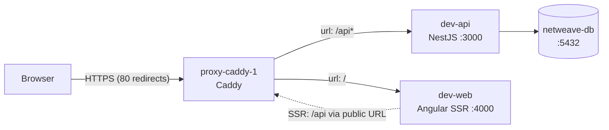

# Netweave

## About

The code written here is a pure result of the private work of Marvin Frede. It is not part of any Employment relationship.\
The code written here also does not contain any code of [Netweave 1.0](https://github.com/Netweave-Managed-Networking/netweave-v1).\
See our [Glossary](./docs/glossary.md) or [Use Case Diagram](./docs/use-case-diagram.puml)

## How to get started

There are two ways to run Netweave locally. Use the source-based workflow for
active development because it runs Angular's development server with live
reload. Use Docker Compose when you want to run the deployment-like stack.

### 1. Shared setup

1. Install Node.js and npm, then install the project dependencies from the
   repository root:

   ```sh
   npm ci
   ```

2. Create the local environment file:

   ```sh
   cp .env.example .env
   ```

3. Fill in the values in `.env`; `.env.example` documents every variable. At
   minimum, configure the PostgreSQL connection, `JWT_SECRET`, and the mail
   settings. Set `SEND_MAIL_ACTIVATED=false` when you do not want the
   application to send mail during local development.

4. Only whitelisted emails can register. On a fresh instance, set
   `REGISTRATION_WHITELIST` (e.g. `you@example.com:admin`) so the first admin
   can register. More emails and domains, each with an optional role, can then
   be allowed from the settings page. New users get the role `viewer` unless
   their whitelist entry says otherwise.

### 2A. Recommended: run from source

This workflow needs Docker for the local database and Mailpit. Start both:

```sh
   docker compose -f docker-compose.local.yml up -d
```

The database uses the credentials from `.env` (`DB_USER`, `DB_PASSWORD`, `DB_DB`) and listens on `localhost:5432`.\
 `docker compose -f docker-compose.local.yml down -v` deletes it for a fresh start.

Start the frontend and API together:

```sh
npm run serve
```

Then open [http://localhost:4200](http://localhost:4200). Nx starts the API as
a dependency of the web development server. The API listens at
[http://localhost:3000/api](http://localhost:3000/api), and the Angular proxy
forwards browser requests under `/api` to it.

The API runs pending migrations when it starts (`synchronize: false`,
`migrationsRun: true`), so the database must be reachable before running
`npm run serve`.

#### Local mail testing (Mailpit)

Set `SEND_MAIL_ACTIVATED=true`, `SMTP_HOST=localhost`, `SMTP_PORT=1025`
and `SMTP_SECURE=false` in `.env`, and leave `SMTP_USER` and `SMTP_PASSWORD`
empty. Caught mail is shown at [http://localhost:8025](http://localhost:8025).
The mail transport can also be changed at runtime on the "Mail-Einstellungen"
admin page; that override is stored in the database and survives a restart.

Mailpit is started together with the database (see [2A. Recommended: run from source](#2a-recommended-run-from-source)).

### 2B. Run with Docker Compose

- `docker-compose.yml` is the server deployment file for one instance (see [Server setup](#server-setup)).
- It starts PostgreSQL, the API and the server-rendered web app from prebuilt images, selected by `IMAGE_TAG`, instead of building the checked-out code.
- It publishes no web port; the separate Caddy proxy (`proxy/docker-compose.yml`) serves it, so it is not meant for local use.\
- For local development use [2A. Recommended: run from source](#2a-recommended-run-from-source).

## Software

This workspace uses [Nx](https://nx.dev) to manage the applications and
libraries.

To explore the project graph, run:

```sh
npm run nx graph
```

To inspect the available targets for either application, run:

```sh
npm run nx show project netweave-web
npm run nx show project netweave-api
```

### Add Projects

Use Nx generators to create new libraries, components, services, ...:

```sh
npm run nx g @nx/angular:library mylib
npm run nx g c apps/netweave-web/src/app/components/.../name
```

Use `npm run nx list` to see installed plugins and
`npm run nx list <plugin-name>` to see their generators.

### Change Database

Use migrations when changing the database schema:

1. Change the relevant entity.
2. Generate a migration, giving it a descriptive name:

   ```sh
   npm run mig:generate -- members-rename-column-age
   ```

   Generated migrations are placed under
   `apps/netweave-api/src/app/db/migrations/`.

3. Import the migration in `apps/netweave-api/src/app/db/db.migrations.ts`.
4. Inspect and run pending migrations against the database configured in
   `.env`:

   ```sh
   npm run mig:show
   npm run mig:run
   ```

## Server setup

As of 2026-10-20.

### Overview

One VPS runs the dev instance (docker-compose.yml) behind a Caddy proxy (proxy/docker-compose.yml)\
Every push to `develop` builds new images and redeploys via `.github/workflows/deploy.yml`.\
Secrets exist only on the server and in GitHub secrets.

### Server and DNS

- Subdomains (like `dev.netweave.de`) are A records at IONOS pointing to the VPS.

### Request flow



### Docker services

Two Compose projects: `proxy` (from `proxy/docker-compose.yml`, name set in the file) and the dev instance `netweave` (from `docker-compose.yml`, name from the folder `~/netweave`).

| Container       | Name on `netweave-proxy` | Project    | Published ports                         | Notes                                                            |
| --------------- | ------------------------ | ---------- | --------------------------------------- | ---------------------------------------------------------------- |
| `proxy-caddy-1` | `proxy-caddy-1`          | `proxy`    | 80, 443 (tcp + udp)                     | mounts `proxy/caddy/`; certificates in volume `proxy_caddy-data` |
| `netweave-api`  | `<INSTANCE_NAME>-api`    | `netweave` | none                                    | healthcheck on `/api`                                            |
| `netweave-web`  | `<INSTANCE_NAME>-web`    | `netweave` | none                                    | listens on 4000 inside Docker                                    |
| `netweave-db`   | not on this network      | `netweave` | 5432 on `127.0.0.1` only for SSH tunnel | data in volume `netweave_db-data`                                |

Start order within the instance: db healthy → api healthy → web.

Networks:

- `netweave_backend` is private to the instance and created by Compose.
- `netweave-proxy` is shared by all projects and created by the deploy if missing. Caddy joins it, and `netweave-api` and `netweave-web` join it as `<INSTANCE_NAME>-api` and `<INSTANCE_NAME>-web`; the database never joins it.

### Files on the server

(see deploy.yml)

```text
~/netweave/
├── docker-compose.yml          # copied by every deploy
├── .env                        # by hand, based on .env.example
└── proxy/
    ├── docker-compose.yml      # copied by every deploy
    └── caddy/
        ├── Caddyfile           # copied by every deploy
        └── sites/              # by hand: one <INSTANCE_NAME>.caddyfile per instance, based on proxy/site.example.caddyfile
```

### Configuration (.env)

All variables are documented in `.env.example`.\
On the server, one `.env` is shared by the api, web and db containers and uses `DB_HOST=netweave-db`.\
`IMAGE_TAG` and `INSTANCE_NAME` are only read by Compose: they pick the image tag and name the instance on the shared proxy network.\
The web container needs no API URL: the frontend calls the relative `/api`, and during SSR Angular resolves that against the requested host, so it goes through Caddy.

### TLS certificates

- Caddy requests and renews a Let's Encrypt certificate for every domain in a site file (CA set via `acme_ca` in `proxy/caddy/Caddyfile`).
- The check runs over port 80 while Caddy keeps running, so renewals cause no downtime.
- Certificates live in the volume `proxy_caddy-data`. Deleting it makes Caddy request new ones.

### Deployment pipeline

`.github/workflows/deploy.yml` runs on every push to `develop`:

1. Build `netweave-api` and `netweave-web` and push them to GHCR, tagged with the branch name and the short commit SHA.
2. Copy `docker-compose.yml`, `proxy/docker-compose.yml` and `proxy/caddy/Caddyfile` to `~/netweave` on the VPS. Then, over SSH: create the shared network if missing, pull images, validate the Caddy config, `docker compose up -d --remove-orphans` for the instance, start the proxy and reload Caddy.
3. Verify that both images exist and that no container of either project is exited or restarting.

Secrets: `VPS_HOST`, `VPS_SSH_PORT`, `VPS_USER`, `VPS_SSH_KEY`, `GHCR_TOKEN`.

### Database and migrations

The API runs pending migrations on startup (see `apps/netweave-api/src/app/db/db.data-source.ts`), so an empty database needs no manual steps.\
Postgres creates the user and database from `DB_USER`, `DB_PASSWORD` and `DB_DB` only on the first start of an empty volume.\
Creating migrations: see [Change Database](#change-database).

### Useful commands

Run on the server in `~/netweave`:

```sh
docker compose ps                                                  # instance container status
docker compose logs -f netweave-api                                # follow API logs
docker compose up -d --force-recreate                              # apply a changed .env
docker compose -f proxy/docker-compose.yml logs -f caddy           # proxy logs, including certificate requests
docker compose -f proxy/docker-compose.yml exec caddy caddy reload --config /etc/caddy/Caddyfile   # apply a changed site file
```

### Observations

- Fixed `container_name` values prevent running a second copy of the instance stack on the same server.
