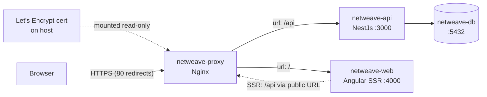

# Netweave

## About

The code written here is a pure result of the private work of Marvin Frede. It is not part of any Employment relationship.\
The code written here also does not contain any code of [Netweave 1.0](https://github.com/Netweave-Managed-Networking/netweave-v1).\
See our [Glossary](./docs/glossary.md) or [Use Case Diagram](./docs/use-case-diagram.puml)

## How to get started

There are two ways to run Netweave locally. Use the source-based workflow for
active development because it runs Angular's development server with live
reload. Use Docker Compose when you want to run the deployment-like stack.

### 1. Shared setup

1. Install Node.js and npm, then install the project dependencies from the
   repository root:

   ```sh
   npm ci
   ```

2. Create the local environment file:

   ```sh
   cp .env.example .env
   ```

3. Fill in the values in `.env`; `.env.example` documents every variable. At
   minimum, configure the PostgreSQL connection, `JWT_SECRET`, and the mail
   settings. Set `SEND_MAIL_ACTIVATED=false` when you do not want the
   application to send mail during local development.

4. Only whitelisted emails can register. On a fresh instance, set
   `REGISTRATION_WHITELIST` (e.g. `you@example.com:admin`) so the first admin
   can register. More emails and domains, each with an optional role, can then
   be allowed from the settings page. New users get the role `viewer` unless
   their whitelist entry says otherwise.

### 2A. Recommended: run from source

This workflow requires a PostgreSQL server running on the local machine. The
database and user must match `.env`; for a local database, keep
`DB_HOST=localhost` and use the configured `DB_PORT` (5432 by default).

Start the frontend and API together:

```sh
npm run serve
```

Then open [http://localhost:4200](http://localhost:4200). Nx starts the API as
a dependency of the web development server. The API listens at
[http://localhost:3000/api](http://localhost:3000/api), and the Angular proxy
forwards browser requests under `/api` to it.

The API runs pending migrations when it starts (`synchronize: false`,
`migrationsRun: true`), so the database must be reachable before running
`npm run serve`.

#### Local mail testing (Mailpit)

To see mail the API sends (invitations etc.) without a real SMTP provider,
start the bundled Mailpit container:

```sh
docker compose -f docker-compose.dev.yml up -d
```

Then set `SEND_MAIL_ACTIVATED=true`, `SMTP_HOST=localhost`, `SMTP_PORT=1025`
and `SMTP_SECURE=false` in `.env`, and leave `SMTP_USER` and `SMTP_PASSWORD`
empty. Caught mail is shown at [http://localhost:8025](http://localhost:8025).
The mail transport can also be changed at runtime on the "Mail-Einstellungen"
admin page; that override is stored in the database and survives a restart.

### 2B. Run with Docker Compose

`docker-compose.yml` is the server deployment file (see
[Server setup](#server-setup)). It starts PostgreSQL, the API, the
server-rendered web app and Nginx, but pulls the prebuilt `latest` images from
GitHub Container Registry instead of building the checked-out code.

```sh
docker compose up -d
```

Running it locally needs:

- the TLS certificate files at `/etc/letsencrypt/live/dev.netweave.de/` (`fullchain.pem`, `privkey.pem`), since Nginx serves `dev.netweave.de` and redirects HTTP to HTTPS,
- `DB_HOST=netweave-db` in `.env`,
- possibly `docker login ghcr.io`, if the images are private.

There is no live reload; for frontend work use 2A. `docker compose down` stops
the stack and keeps the database volume; `docker compose down -v` also deletes
the database.

## Software

This workspace uses [Nx](https://nx.dev) to manage the applications and
libraries.

To explore the project graph, run:

```sh
npm run nx graph
```

To inspect the available targets for either application, run:

```sh
npm run nx show project netweave-web
npm run nx show project netweave-api
```

### Add Projects

Use Nx generators to create new libraries, components, services, ...:

```sh
npm run nx g @nx/angular:library mylib
npm run nx g c apps/netweave-web/src/app/components/.../name
```

Use `npm run nx list` to see installed plugins and
`npm run nx list <plugin-name>` to see their generators.

### Change Database

Use migrations when changing the database schema:

1. Change the relevant entity.
2. Generate a migration, giving it a descriptive name:

   ```sh
   npm run mig:generate -- members-rename-column-age
   ```

   Generated migrations are placed under
   `apps/netweave-api/src/app/db/migrations/`.

3. Import the migration in `apps/netweave-api/src/app/db/db.migrations.ts`.
4. Inspect and run pending migrations against the database configured in
   `.env`:

   ```sh
   npm run mig:show
   npm run mig:run
   ```

## Server setup

As of 2026-10-17.

### Overview

One VPS runs the stack from `docker-compose.yml` at https://dev.netweave.de.\
Every push to `develop` builds new images and redeploys via `.github/workflows/deploy.yml`.\
Secrets exist only on the server and in GitHub secrets.

### Server and DNS

- VPS: certbot runs on the host, not in Docker.
- `dev.netweave.de` and `dummy.netweave.de` (configured at ionos) both have an A record to the VPS.
  - `dummy` has no configuration of its own yet, so Nginx answers it with the dev server block and certificate.

### Request flow



### Docker services

Compose project `netweave` (from the folder name `~/netweave`); details in `docker-compose.yml`.

| Container        | Published ports          | Notes                                  |
| ---------------- | ------------------------ | -------------------------------------- |
| `netweave-proxy` | 80, 443                  | mounts `nginx/nginx.conf` and the cert |
| `netweave-api`   | none                     | healthcheck on `/api`                  |
| `netweave-web`   | none                     | listens on 4000 inside Docker          |
| `netweave-db`    | 5432 on `127.0.0.1` only | data in volume `netweave_db-data`      |

Start order: db healthy → api healthy → web → Nginx.

### Files on the server

```text
~/netweave/
├── docker-compose.yml   # copied by every deploy
├── .env                 # by hand, based on .env.example
└── nginx/
    └── nginx.conf       # by hand, identical to nginx/nginx.conf in this repo
```

### Configuration (.env)

All variables are documented in `.env.example`.\
On the server, one `.env` is shared by the api, web and db containers and uses `DB_HOST=netweave-db`.\
The web container needs no API URL: the frontend calls the relative /api, and during SSR Angular resolves that against the requested host, so it goes through Nginx

### TLS certificates

- One Let's Encrypt certificate for `dev.netweave.de` (ECDSA) in `/etc/letsencrypt/live/dev.netweave.de/`.
- Renewal: `certbot.timer` (twice a day, renews within 30 days of expiry) with the `standalone` authenticator. `certbot renew --dry-run` succeeds.
- Hooks in `/etc/letsencrypt/renewal-hooks/` free port 80: `pre/stop-nginx.sh` and `post/start-nginx.sh` run `docker compose -f /home/marv/netweave/docker-compose.yml stop|start nginx`. They depend on that path and the service name `nginx`.
  - Nginx is down for about 15 seconds per renewal run, and also during every dry run. The hooks run once per run, not once per certificate.
- Nginx mounts `fullchain.pem` and `privkey.pem` as single files. That is fine: `start` makes Docker resolve the `live/` symlinks again, so Nginx picks up the renewed certificate.

### Deployment pipeline

`.github/workflows/deploy.yml` runs on every push to `develop`:

1. Build `netweave-api` and `netweave-web` and push them to GHCR, tagged with the short commit SHA and `latest`.
2. Copy `docker-compose.yml` to `~/netweave` on the VPS, then run `docker compose pull` and `docker compose up -d --remove-orphans` over SSH.
3. Verify that both images exist and that no container is exited or restarting.

Secrets: `VPS_HOST`, `VPS_SSH_PORT`, `VPS_USER`, `VPS_SSH_KEY`, `GHCR_TOKEN`.

### Database and migrations

The API runs pending migrations on startup (see `apps/netweave-api/src/app/db/db.data-source.ts`), so an empty database needs no manual steps.\
Postgres creates the user and database from `DB_USER`, `DB_PASSWORD` and `DB_DB` only on the first start of an empty volume.\
Creating migrations: see [Change Database](#change-database).

### Useful commands

Run on the server in `~/netweave`:

```sh
docker compose ps                        # container status
docker compose logs -f netweave-api      # follow API logs
docker compose restart nginx             # apply a changed nginx.conf
docker compose up -d --force-recreate    # apply a changed .env
sudo certbot certificates                # certificate status
sudo certbot renew --dry-run             # test certificate renewal
```

### Observations

- `deploy.yml` does not copy `nginx/nginx.conf`; config changes must be applied on the server by hand.
- Fixed `container_name` values and host ports prevent running a second copy of the stack on the same server.
